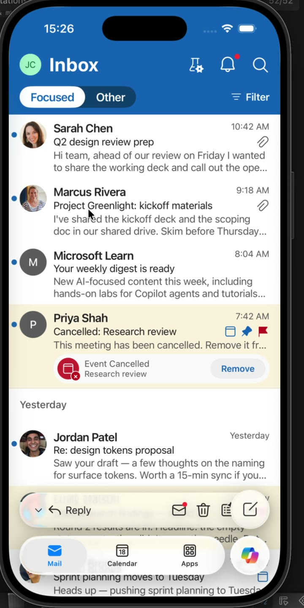

# Outlook iOS Boilerplate

A SwiftUI and Xcode starter project for exploring Outlook-style mobile
interactions, motion, and AI-assisted experiences in a realistic app shell.

## Demo

[](media/outlook-ios-boilerplate-demo.mp4)

**[Watch the full 43-second recording](media/outlook-ios-boilerplate-demo.mp4)**

The demo uses fictional names, messages, and scenarios. It does not connect to
mail accounts, production services, or real user data.

## What Is Included

- An Outlook-style inbox and reading experience on iOS
- Navigation between mail surfaces
- Liquid Glass-inspired navigation and action controls
- AI summary presentation and follow-up actions
- A reusable mobile shell for rapidly testing interaction concepts
- FluentUI Apple `0.35.0`
- Shared color tokens and a token-generation utility

## Requirements

- macOS with Xcode
- An iOS 26.2 or newer simulator
- Internet access on the first build so Swift Package Manager can resolve
	FluentUI Apple

## Run the Project

```bash
git clone https://github.com/meksharma/outlook-ios-boilerplate.git
cd outlook-ios-boilerplate
open OutlookBoilerplate.xcodeproj
```

Choose an iPhone simulator in Xcode and press **Run**. The first build may take
longer while Swift Package Manager downloads FluentUI.

## Project Structure

```text
OutlookBoilerplate/
├── Inbox/                 # Inbox header, rows, sample threads, actions
├── Reading/               # Reading pane and action bar
├── Compose/               # New-mail flow and compose toolbar
├── Copilot/               # AI sheet variants
├── Drawer/                # Side navigation
├── OutlookBackdrop/       # Local Swift package and shared tokens
├── Assets.xcassets/       # App images and colors
├── Avatars.xcassets/      # Fictional sample contacts
└── Icon Inbox.xcassets/   # Interface icons
```

## Sample Data

All names, messages, and scenarios in the app are fictional. The project does
not connect to mail accounts, production services, or real user data.

## Recording

The attached MP4 is optimized for GitHub viewing:

- Duration: 43 seconds
- Resolution: 720 × 1440
- Frame rate: 30 fps
- Format: H.264 MP4